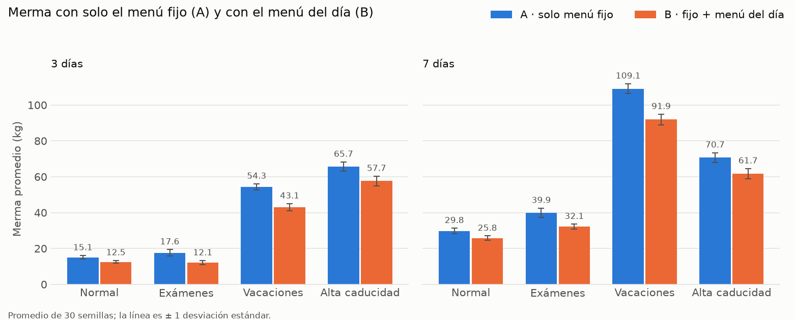
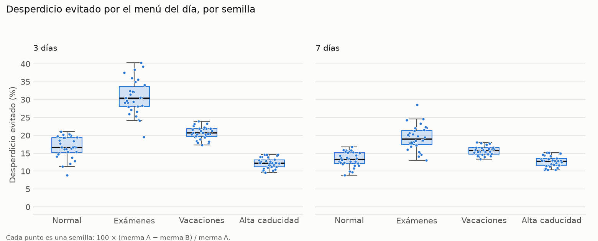

# Evaluación por simulación (OP4)

Esta sección corresponde al apartado 8 del reporte técnico (#32). Todos los números salen de `resultados/`, que se regenera con un comando (ver el final). Si un número cambia, la prueba `test_los_resultados_guardados_estan_al_dia` falla hasta que se vuelvan a generar los resultados y se actualice este texto.

## 8.1 Qué se comparó y cómo

**Pregunta.** ¿Cuánto desperdicio y cuánto dinero ahorra un puesto de comida con menú fijo si cada día agrega el menú del día que propone el voraz?

| Escenario | Qué vende cada día |
|---|---|
| **A** | Solo el menú fijo |
| **B** | El menú fijo y, además, el menú del día que genera el voraz con el inventario de ese día |

**Simulador** (`src/menucero/simulacion.py`, #25). Avanza día por día con el inventario inicial y **sin reposición**:

1. Se atiende primero el menú fijo. Si no alcanza el inventario, el resto son porciones no atendidas.
2. En B, se vende después el menú del día.
3. Lo que llega a su fecha de caducidad sin usarse es **merma**.

La demanda de cada platillo es aleatoria (Poisson, con media la demanda estimada). A y B con la misma semilla atienden exactamente a los mismos clientes del menú fijo, así que la diferencia entre ambos se debe solo al menú del día.

**Configuración** (`scripts/simular.py`, #28):

- 4 escenarios de `data/escenarios` (#19), todos con inicio el miércoles 25 de noviembre de 2026:
  - normal;
  - exámenes (demanda × 0.80);
  - vacaciones (demanda × 0.25);
  - alta caducidad (regreso de un puente, con 8 ingredientes ya caducados).
- 2 horizontes: 3 días, que es lo que duran las compras del dataset, y 7 días, el horizonte que pide #25.
- 30 semillas por escenario y horizonte: 240 parejas A–B en total.
- Voraz: **el prototipo v0** (`prototipo/voraz_v0.py`), porque el voraz principal (#20) todavía no está en `main`. Cuando lo esté, el simulador lo usa sin cambios y basta regenerar los resultados.
- Métricas (#22):
  - desperdicio evitado = 100 × (merma A − merma B) / merma A;
  - costo ahorrado = Σ costo_kg × (merma A − merma B), por ingrediente.

## 8.2 Resultados

**Tabla 1.** Merma con solo el menú fijo (A) y con el menú del día (B). Promedio ± desviación estándar de 30 semillas. Entre corchetes, el intervalo de confianza del 95 % del promedio del desperdicio evitado.

| Escenario | Días | Merma A (kg) | Merma B (kg) | Desperdicio evitado (%) | Costo ahorrado ($) |
|---|---:|---:|---:|---:|---:|
| Normal | 3 | 15.05 ± 1.08 | 12.53 ± 0.82 | 16.7 ± 3.0 [15.5, 17.8] | 154.92 ± 56.64 |
| Exámenes | 3 | 17.55 ± 1.84 | 12.12 ± 1.18 | 30.7 ± 4.8 [28.9, 32.5] | 423.77 ± 104.78 |
| Vacaciones | 3 | 54.30 ± 1.75 | 43.08 ± 1.93 | 20.7 ± 1.7 [20.0, 21.3] | 756.44 ± 70.52 |
| Alta caducidad | 3 | 65.71 ± 2.54 | 57.66 ± 2.70 | 12.3 ± 1.5 [11.7, 12.8] | 478.28 ± 70.24 |
| Normal | 7 | 29.80 ± 1.50 | 25.82 ± 1.18 | 13.3 ± 2.0 [12.5, 14.0] | 158.92 ± 62.22 |
| Exámenes | 7 | 39.91 ± 2.62 | 32.14 ± 1.45 | 19.3 ± 3.4 [18.0, 20.6] | 452.90 ± 100.86 |
| Vacaciones | 7 | 109.09 ± 2.78 | 91.90 ± 2.98 | 15.8 ± 1.2 [15.3, 16.2] | 1,149.68 ± 93.39 |
| Alta caducidad | 7 | 70.67 ± 2.74 | 61.70 ± 2.86 | 12.7 ± 1.5 [12.2, 13.3] | 546.37 ± 73.64 |

*Fuente: elaboración propia con `resultados/simulacion.csv` y `resultados/resumen.md`.*

**Lo principal.**

- **B tuvo menos merma que A en las 240 parejas.** El peor caso evitó el 8.8 % y el mejor el 40.3 %.
- Ningún intervalo de confianza se acerca a 0. La mejora no es efecto del azar de la demanda.
- En promedio, el menú del día evita entre el **12 % y el 31 %** de la merma, según el escenario y el horizonte.



**Figura 1.** Merma promedio de A y B por escenario. La línea es ± 1 desviación estándar. *Fuente: `resultados/merma_a_vs_b.png`.*

**Cómo leer la Figura 1.**

- En los cuatro escenarios y los dos horizontes, la barra de B es más baja que la de A, y sus barras de error no se tocan.
- La diferencia en kg es mayor donde más se desperdicia: vacaciones y alta caducidad. En porcentaje, la mayor diferencia está en exámenes.
- Vacaciones es el escenario con más merma. Con la demanda en 25 %, el inventario de una semana normal no se alcanza a usar, y el menú del día rescata 11 kg en 3 días, pero no puede vender lo que nadie pide.



**Figura 2.** Desperdicio evitado en cada una de las 30 semillas. *Fuente: `resultados/desperdicio_evitado.png`.*

**Cómo leer la Figura 2.**

- Todas las cajas están por encima de 0.
- **Exámenes** tiene el mayor beneficio y también la mayor dispersión (de 19.5 % a 40.3 % con 3 días). Con la demanda al 80 %, el menú fijo deja más sobrante cada día, y el menú del día tiene más qué rescatar y clientes que lo compran.
- **Alta caducidad** tiene la caja más baja y más angosta: 15.7 kg ya están caducados al empezar, y esa merma no la evita ningún menú.
- Con 7 días el porcentaje baja en todos los escenarios menos alta caducidad. Sin reposición, desde el día 3 el menú fijo se queda sin ingredientes (ver 8.4), y ambos escenarios desperdician lo que ya no se puede cocinar.

## 8.3 Contraste con lo esperado

En la Actividad 03 se estimó que, en la demostración con 40 ingredientes, *«solo con el menú fijo, podría perderse hasta el 60 % de esos ingredientes»*: los que vencen en menos de 48 horas.

**Tabla 2.** Porcentaje de los kg de los ingredientes urgentes que termina como merma. Son los que vencen hoy o mañana al empezar: los 8 de la demostración en el escenario normal. Promedio ± desviación estándar de 30 semillas, con 3 días.

| Escenario | Kg urgentes | Se pierde en A (%) | Se pierde en B (%) | Diferencia (puntos) |
|---|---:|---:|---:|---:|
| Normal (la demostración) | 15.71 | 61.8 ± 3.0 | 42.8 ± 3.1 | −19.0 |
| Exámenes | 17.16 | 56.4 ± 3.9 | 35.8 ± 2.9 | −20.6 |
| Vacaciones | 21.76 | 85.1 ± 3.2 | 69.3 ± 3.3 | −15.8 |
| Alta caducidad¹ | 72.91 | 66.4 ± 3.5 | 55.4 ± 3.7 | −11.0 |

*Fuente: elaboración propia con `resultados/simulacion.csv`. Con 7 días los porcentajes son iguales, porque los urgentes caducan en los primeros 2 días.*
¹ En alta caducidad los 8 de la demostración ya caducaron. Los urgentes son otros 18 ingredientes que el cierre de 2 días dejó a 0 o 1 día de vencer.

**Lectura.**

- **La estimación de la Actividad 03 se confirma.** En la demostración (escenario normal), solo con el menú fijo se pierde el **61.8 %** de los ingredientes urgentes, prácticamente el 60 % estimado. En exámenes se pierde un poco menos y en vacaciones bastante más.
- Con el menú del día, esa pérdida baja a **42.8 %**. Se rescatan unos 3 kg de los 15.7 kg urgentes.
- El menú del día **no elimina** la pérdida. En la demostración, todavía se pierden 6.7 kg urgentes. Hay dos razones:
  - Su demanda está limitada: solo se venden las porciones adicionales que se estima que piden los clientes.
  - Varios urgentes son ingredientes que pocas recetas usan, en poca cantidad por porción.
- La diferencia es clara, como se esperaba, pero no es del orden de «casi todo se rescata». Así hay que presentarla.

## 8.4 Efecto secundario: porciones del menú fijo no atendidas

El menú fijo se atiende antes que el menú del día, así que **el mismo día** nunca pierde porciones por él. Pero el v0 gasta todo lo *disponible* de un ingrediente, no solo lo que está en riesgo, y puede dejar sin lo necesario al menú fijo de **los días siguientes**.

| Escenario | No atendidas A (3 días) | No atendidas B (3 días) | Diferencia |
|---|---:|---:|---:|
| Normal | 296.4 | 310.7 | +14.3 (+4.8 %) |
| Exámenes | 183.0 | 220.7 | +37.7 (+20.6 %) |
| Vacaciones | 25.9 | 25.9 | 0 |
| Alta caducidad | 461.6 | 461.7 | +0.1 |

*Fuente: `resultados/resumen.md`.*

- Las porciones no atendidas son altas en A y en B. Es efecto de no reponer inventario (ver 8.5), no del menú del día.
- La diferencia entre B y A sí es atribuible al v0. Es el mismo sobreuso que se encontró al compararlo en #42.
- **Recomendación para #20:** que el voraz principal limite cada ingrediente a sus kg en riesgo, o que reserve el consumo del menú fijo de todos los días que le quedan, no solo el de hoy.

## 8.5 Limitaciones

1. **Demanda estimada.**
   - La demanda de cada platillo sale de la caracterización (#8), no de ventas reales.
   - El ruido Poisson representa la variación diaria, pero no cambios de preferencia, clima ni promociones.
   - La demanda del menú del día es la parte más incierta: nadie la ha medido.
2. **Sin reposición.**
   - El inventario inicial es todo lo que hay. En un negocio real se compra cada 1 a 3 días.
   - Con 7 días, el menú fijo se queda sin ingredientes desde el día 3, y quedan sin atender unas 1100 porciones en el escenario normal. Esa merma aparece por igual en A y en B, y baja el porcentaje evitado.
   - Por eso el horizonte de 3 días, que coincide con el ciclo de compra del dataset, es el resultado más representativo.
3. **Supuesto de venta del menú del día.**
   - El modelo base supone que el menú del día se prepara sobre pedido. Lo que no se vende no se prepara.
   - Para medir qué tanto depende el resultado de este supuesto, se corrió una prueba más estricta: el menú del día se prepara completo al inicio del día, se vende el 100, 75 o 50 % de su demanda estimada, y **lo que sobra se tira como merma** (Tabla 3, Figura 3).
4. **Datos sintéticos.**
   - El inventario, las recetas y los costos son de un puesto *tipo*, construido a partir de la caracterización (#8), no de un negocio real.
   - El generador parametrizable (#17) todavía no está, así que no se probaron otros tamaños ni otras composiciones del inventario.
5. **Voraz provisional.** Los resultados son del prototipo v0. El voraz principal (#20) debería mejorar el efecto secundario de 8.4. Hay que regenerar los resultados cuando esté en `main`.

**Tabla 3.** Sensibilidad al supuesto de venta: 3 días, menú del día preparado completo y sobrantes tirados. Promedio ± desviación estándar de 30 semillas; entre corchetes, el mínimo y el máximo.

| Escenario | Se vende | Desperdicio evitado (%) | Porciones sobrantes de B |
|---|---:|---:|---:|
| Normal | 100 % | 13.2 ± 4.7 [3.0, 20.3] | 2.9 |
| Normal | 75 % | 7.4 ± 8.3 [−16.7, 19.5] | 7.2 |
| Normal | 50 % | −1.1 ± 7.9 [−18.2, 11.2] | 13.1 |
| Exámenes | 100 % | 13.8 ± 10.9 [−22.2, 30.5] | 12.0 |
| Exámenes | 75 % | −4.4 ± 9.0 [−27.5, 8.4] | 23.6 |
| Exámenes | 50 % | −29.0 ± 13.9 [−71.0, −10.3] | 40.1 |
| Vacaciones | 100 % | 14.1 ± 2.9 [9.4, 19.0] | 28.9 |
| Vacaciones | 75 % | 7.5 ± 3.0 [2.1, 14.0] | 42.5 |
| Vacaciones | 50 % | −0.5 ± 3.4 [−6.2, 4.6] | 58.4 |
| Alta caducidad | 100 % | 11.6 ± 1.8 [9.1, 14.6] | 7.7 |
| Alta caducidad | 75 % | 9.8 ± 1.7 [7.2, 12.8] | 12.7 |
| Alta caducidad | 50 % | 5.8 ± 1.6 [1.4, 9.2] | 22.3 |

*Fuente: elaboración propia con `resultados/sensibilidad_venta.csv`.*


**Figura 3.** Desperdicio evitado según la parte vendida del menú del día, cuando se prepara completo y lo que sobra se tira. Bajo 0, B tira más que A. *Fuente: `resultados/sensibilidad_venta.png`.*

**Lectura.** **Este es el supuesto que más pesa.**

| Se vende | B tiene menos merma que A en |
|---:|---:|
| 100 % | 119 de 120 corridas |
| 75 % | 96 de 120 corridas |
| 50 % | 60 de 120 corridas: la mitad |

- **Exámenes** es el caso más sensible: con 75 % de venta, el menú del día ya tira más de lo que rescata.
- **Alta caducidad** es el más robusto: los ingredientes que rescata se iban a perder de todos modos.

La conclusión práctica para el negocio es **preparar el menú del día por tandas, o solo hasta la demanda segura**, en lugar de prepararlo todo de una vez. Para el algoritmo, es otra razón para que el voraz principal no proponga más porciones de las necesarias para salvar los kg en riesgo. Es una de las mejoras planteadas para el voraz definitivo en `prototipo/voraz_v0.py`: que *«no prepare más porciones de las que hacen falta para salvar un ingrediente»*.

## 8.6 Conclusión respecto del objetivo general

El objetivo general era generar un menú del día que priorice los ingredientes próximos a caducar *«con el fin de reducir el desperdicio de ingredientes y su costo en comparación con trabajar solo con el menú fijo, lo cual se comprobará mediante simulaciones con datos de prueba»*.

Con los datos de prueba y el modelo de simulación descritos, **el objetivo se cumple**:

- El menú del día redujo la merma en las 240 parejas de corridas: en promedio, del **12 % al 31 %** según el escenario.
- Ahorró de **$155 a $1,150** de ingredientes en el horizonte simulado.
- En la demostración, bajó la pérdida de los ingredientes urgentes del **61.8 % al 42.8 %**.

**Esta conclusión tiene dos condiciones:**

1. **El menú del día tiene que venderse.** Si se prepara completo y se vende el 75 % o menos de lo estimado, el beneficio desaparece en los escenarios normal y exámenes.
2. **Las cifras son del prototipo v0 con datos sintéticos.** Son evidencia de que el enfoque funciona en un puesto tipo, no una medición en un negocio real.

El siguiente paso es regenerar estos resultados con el voraz principal (#20) y comprobar si reduce el sobreuso descrito en 8.4.

## Cómo reproducir

```bash
uv run python scripts/simular.py
```

Tarda unos 3 segundos y escribe en `resultados/`:

| Archivo | Contenido |
|---|---|
| `simulacion.csv` | Una fila por escenario, horizonte y semilla |
| `resumen.csv` / `resumen.md` | Tablas 1 y 2 |
| `sensibilidad_venta.csv` | Tabla 3 |
| `merma_a_vs_b.png` | Figura 1 |
| `desperdicio_evitado.png` | Figura 2 |
| `sensibilidad_venta.png` | Figura 3 |

Los intervalos de confianza de la Tabla 1 se calculan con la t de Student: promedio ± 2.045 × desviación / √30.
